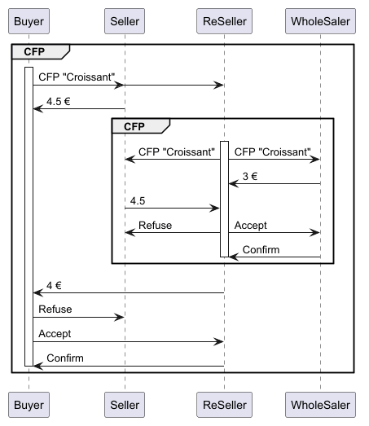
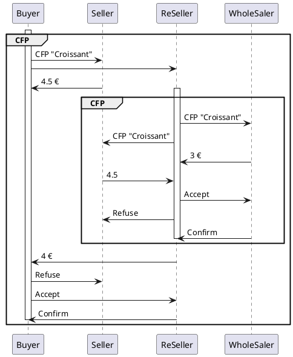

# Nested protocols : a reseller

A **buyer** wants a croissant : it launches a call for proposals (FIPA-Contract-Net) to the sellers of the market.  
The **reseller** has no croissant : **before answering**, it launches its own call for proposals to the **wholesaler**
(that the buyer does not know) and to the other sellers, buys the cheapest croissant, and proposes it to the buyer with a margin.


<!--

-->
---

## The nested protocol ([ResellerAgent](agents/ResellerAgent.java))

The reseller has a `ContractNetResponder` (the buyer has a `ContractNetOInitiator`) ; but its step *handle CFP* is replaced by another `ContractNetInitiator`
(the call to the suppliers) :

```java
//FOR Reseller Agent
//a classic ContractNetResponder except for HandleCfp 
var responder = new ContractNetResponder(this, template) { ... handleAcceptProposal, handleRejectProposal ... };

//a protocol is a finite state machine (FSM): we redirect the state handleCFP to a behaviour which is another CFP (the reseller try tu buy the product before selling it)  
responder.registerHandleCfp(new ContractNetInitiator(this, new ACLMessage(ACLMessage.CFP)) {
    protected List<ACLMessage> prepareCfps(ACLMessage ignored) {
        // reads the CFP of the buyer
        ACLMessage buyerCfp = getMapMessages().get(responder.CFP_KEY);     
        ...                                                                
        // and asks the same item to the suppliers
    }
    // accepts the cheapest supplier or seller
    protected void handleAllResponses(...) { ... }
    // the supplier or another seller confirms
    protected void handleInform(ACLMessage inform) {
        // writes the answer to the buyer
        //in each protocol, messages are in a map
        //we get the map from the first CFP that has been partly defined
        //and has an answer to the handle CFP, we put the proposal as a reply of the responder
        getMapMessages().put(responder.REPLY_KEY, proposal);               
    }
});
addBehaviour(responder);
```

The two behaviours **share their maps of messages** : the inner Contract Net reads the CFP of the buyer, and writes the PROPOSE  that the responder sends to the buyer.

**The seller is asked twice at the same time!** : by the buyer, and by the reseller while the buyer waits.  
It must answer the reseller before the buyer has decided : it opens **one session per CFP** (`SSResponderDispatcher`).  
With a simple `ContractNetResponder`, it would handle the CFP of the reseller only after the decision of the buyer... who waits for the reseller.  
Look at the code in the SellerAgent...  
*We could do the same for the reseller... When multiple client, the reseller can be contacted in quasi parallel... For the moment in this code, only 1 agent at a time can launch a cfp with the reseller.*


---

## Launch

Launch [LaunchAgents](launch/LaunchAgents.java) : 
- a buyer, 
- a seller (4.5 €) 
- and the reseller (margin 1 €) on the market, 
- a wholesaler (3 €) known only by the reseller. 
- The buyer buys a croissant 2 s after the start, then at each click on its button.
